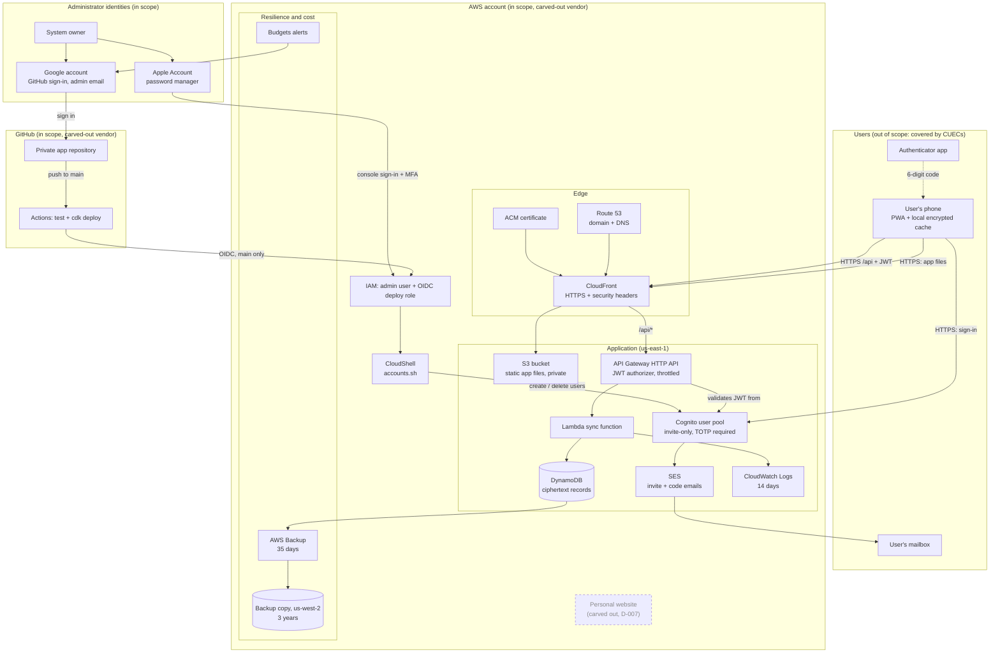

# Boundary & Architecture Diagram

As of 2026-10-29, system version `tracker@9124656`. Dashed boxes are out of scope or carved out. See section 4 of the [system description](system-description.md) for the reasons.

## Reading the diagram

- **Two paths reach production.** Code reaches production through Google → GitHub → Actions → the OIDC role. Account administration goes through the administrator's stored credentials → IAM → CloudShell. Both admin identities are therefore in scope (D-008, proposed).
- **The personal website is carved out**, but it sits inside the same AWS account. Account-level controls (root, admin, billing, DNS) cover both, so they stay in scope (D-007).
- **Users' devices are out of scope**, but the system relies on users protecting them. Those duties are listed as CUECs in the system description.
