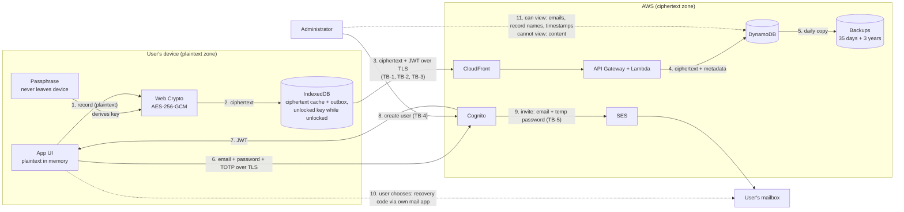

# Data Flow Diagram

As of 2026-10-29, system version `tracker@9124656`. Shows where each kind of data goes, what form it is in (plaintext or ciphertext), and where it crosses a trust boundary.

## Trust boundaries

| ID | Boundary | Why it matters |
|---|---|---|
| TB-1 | User's device ↔ internet | Plaintext exists only on the device side. Everything that crosses is ciphertext, credentials or tokens, all over TLS |
| TB-2 | Internet ↔ AWS edge (CloudFront) | Public entry point. Security headers and HTTPS are enforced here |
| TB-3 | AWS edge ↔ application services | Every API call must carry a valid Cognito JWT |
| TB-4 | Administrator ↔ AWS account and GitHub | Privileged access. Can change code, infrastructure and accounts, but cannot read user content |
| TB-5 | AWS ↔ outside email | Invitation emails (with a temporary password) and codes leave AWS through SES |

## Diagram

## Flow details

| # | Data | Form | From → To | Protection |
|---|---|---|---|---|
| 1 | User content (all categories) | Plaintext | UI → Web Crypto | Stays in the browser's memory |
| 2 | Encrypted records | Ciphertext | Web Crypto → IndexedDB | AES-256-GCM with a fresh IV; user ID and record key bound as AAD |
| 3 | Encrypted records, JWT | Ciphertext + token | Device → CloudFront → API | TLS; JWT required; throttling |
| 4 | Encrypted records + metadata | Ciphertext; metadata in clear | Lambda → DynamoDB | User ID taken only from the verified token; AWS encryption at rest |
| 5 | Table backups | Ciphertext + metadata | DynamoDB → AWS Backup → second region | Backup vaults; retention 35 days and 3 years |
| 6 | Email, password, TOTP code | Credentials | Device → Cognito | TLS; Cognito handles password storage |
| 7 | ID and access tokens | Token | Cognito → device | 1-hour tokens; 30-day refresh token |
| 8 | New user's email | PII | Administrator → Cognito | Admin MFA; CloudShell (no stored keys) |
| 9 | Invitation with temporary password | Credential in email | Cognito → SES → user's mailbox | Temporary password expires in 7 days and must be changed. Email transport security depends on the receiving mail provider |
| 10 | Recovery code | Secret | Device → user's own mail app | Never sent through the system. Optional. The user's mailbox becomes a place where the code is stored (CUEC) |
| 11 | Admin view of the table | Metadata | DynamoDB → administrator | Content unreadable. Record names show which days have entries |

## What this diagram shows

- **Plaintext never leaves the device.** That one fact shapes most of the later risk and privacy analysis. It is also why compliance trigger T-07 exists: any feature that needs server-side plaintext changes the whole picture.
- **Metadata is not encrypted.** Record names like `day#2026-10-26` and timestamps are visible to the administrator and to AWS. They show activity patterns, not content.
- **Email is the weakest flow.** The invitation with a temporary password, and optionally the recovery code, travel through mail systems this program does not control.
