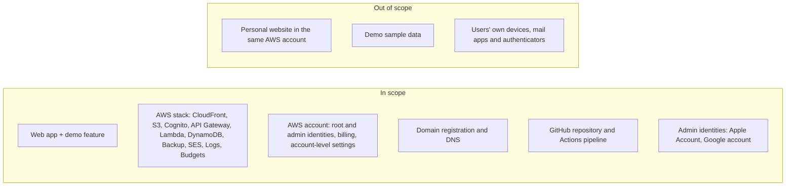

# System Description: Khas Tracker

| | |
|---|---|
| **Document owner** | Muhammad Khas |
| **Version** | 0.1 (draft) |
| **As of** | 2026-10-29 |
| **System version described** | `tracker@9124656` |
| **Format** | Modeled on a SOC 2 Section III system description, following the AICPA Description Criteria (DC 200) |
| **Status** | Draft for Phase 0. Not audited. |

> Facts in this document come from the system's infrastructure code and from interviews with the system owner. Facts not yet verified against the live AWS account are marked **(unverified)** and are checked in Phase 4. Assumptions are marked **(assumption)**.

---

## 1. Overview of operations

Khas Tracker is a private daily-life and fitness tracker. It installs on a phone home screen as a Progressive Web App (PWA). People use it to log daily habits and tasks, wellbeing check-ins, religious practice (make-up prayers and fasts), food, training, weight, blood pressure, waist and sleep, and goals.

The service is run by one person, the system owner, on AWS. Accounts are invite-only. As of 2026-10-29 there are **10 active users**, all friends and family of the owner, and **no users under 18**. The service is free, has no advertising or analytics, and is not offered to the public.

A demo mode with made-up sample data is available on the sign-in screen so people can see the app before getting an account.

## 2. Principal service commitments and system requirements (DC 2)

Khas Tracker has no written customer contract or terms of service. The commitments below are the ones made to users in the invitation email and in the app's setup screens. They are the commitments this program is built to support.

| # | Commitment | Where it is made |
|---|---|---|
| SC-1 | Everything a user logs is encrypted on their own phone before it is sent, so nobody else can read it, including the person who runs the app | Invitation email; setup screen; Settings |
| SC-2 | There are no ads, trackers or analytics | Invitation email |
| SC-3 | Accounts are invite-only and require a password plus an authenticator code | Invitation email; sign-in flow |
| SC-4 | The app works offline and syncs when back online | Invitation email; header status |
| SC-5 | If a user loses both their passphrase and recovery code, their data cannot be recovered by anyone | Setup screen |

**System requirements** that follow from these commitments:
- User data is stored and transmitted only as ciphertext produced on the user's device.
- Each user can read and write only their own records.
- Administrative access is limited to the system owner and protected with MFA.
- Data is backed up and can be restored.
- No third-party scripts or tracking are loaded by the app.

**Gap:** there is no written privacy notice or terms of service. Users were not shown one before their accounts were made. This is addressed in Phase 6. See also compliance trigger T-04 in [compliance-triggers.md](compliance-triggers.md).

## 3. Components of the system (DC 3)

### 3.1 Infrastructure

All infrastructure runs in a single AWS account, in `us-east-1`, with backup copies in `us-west-2`. It is defined as code with AWS CDK in one CloudFormation stack.

| Component | Purpose | Key configuration | Evidence |
|---|---|---|---|
| Amazon S3 | Holds the web app's static files | All public access blocked; S3-managed encryption; TLS required | `tracker@9124656:infra/lib/tracker-stack.ts:226-230` |
| Amazon CloudFront | Serves the app over HTTPS and routes `/api/*` to the API | Origin Access Control to S3; HTTP redirected to HTTPS; security headers (CSP, HSTS, frame denial, no referrer, noindex) | `tracker-stack.ts:232-283` |
| AWS Certificate Manager | TLS certificate for the app's domain name | DNS-validated | `tracker-stack.ts:222-225` |
| Amazon Route 53 | Domain registration and DNS for the app's subdomain | Domain registered through AWS; auto-renew on. Transfer lock **(unverified)** | Interview; `tracker-stack.ts:219, 284-286` |
| Amazon Cognito | User accounts and sign-in | Self sign-up off; TOTP MFA required, SMS off; 10-character minimum password; 1-hour tokens; 30-day refresh; deletion protection | `tracker-stack.ts:124-169` |
| Amazon API Gateway (HTTP API) | The sync API | Four routes, each requiring a valid Cognito JWT; throttled to 10 requests/second, burst 20 | `tracker-stack.ts:197-216` |
| AWS Lambda | Reads and writes encrypted records | Node.js 22 on ARM; takes the user ID only from the verified token | `tracker-stack.ts:182-195`; `infra/lambda/api.mjs:111` |
| Amazon DynamoDB | Stores encrypted records | Partition key = user ID; point-in-time recovery on; deletion protection on | `tracker-stack.ts:172-179` |
| AWS Backup | Daily backups of the table | Kept 35 days; copy to a second region kept 3 years | `tracker-stack.ts:308-324` |
| Amazon SES | Sends account invitation and code emails from the app's domain | DKIM records published in Route 53 | `tracker-stack.ts:144-150, 221` |
| Amazon CloudWatch Logs | Lambda logs | Kept 14 days | `tracker-stack.ts:190-193` |
| AWS Budgets | Cost alerts by email | Alerts at 80% of actual and 100% of forecast monthly budget | `tracker-stack.ts:326-339` |
| AWS IAM + GitHub OIDC | Lets GitHub Actions deploy without stored AWS keys | Role can be assumed only from the `main` branch of the app repository; 1-hour sessions | `tracker-stack.ts:341-364` |

**Account-level services not defined in the stack:** whether a CloudTrail trail, GuardDuty, Security Hub or AWS Config is enabled is **(unverified)**. The owner believes CloudTrail is on.

### 3.2 Software

| Component | Description |
|---|---|
| Web app | Plain HTML, CSS and JavaScript (ES modules, no framework). Runs entirely in the browser. Encryption uses the browser's Web Crypto API. A service worker caches the app for offline use. |
| Sync API | One Lambda function (`infra/lambda/api.mjs`) with list, get, batch-write and delete operations. Last write wins per record. |
| Infrastructure code | AWS CDK in TypeScript (`infra/`). |
| Admin script | `accounts.sh`, run in AWS CloudShell: create, list, disable, enable, reset, sign out and delete accounts. |
| CI/CD | GitHub Actions workflow (`.github/workflows/deploy.yml`): on every push to `main`, installs dependencies, runs tests and checks, then runs `cdk deploy`. |

**Encryption design** (`web/js/crypto.js`): on first use, the device creates a random 256-bit data key. That key is wrapped twice: once with a key derived from the user's passphrase (PBKDF2-SHA256, 600,000 iterations) and once with a key derived from a random recovery code. Only the wrapped copies (the "keyring") are stored in the cloud. Each record is encrypted with AES-256-GCM, a fresh random IV, and the user ID plus record key as additional authenticated data. Records are also stored as ciphertext in the phone's local database.

### 3.3 People

| Role | Who | Responsibilities |
|---|---|---|
| System owner and administrator | Muhammad Khas (one person) | All development, deployment, AWS and GitHub administration, account management, user support, security, and this GRC program |
| Users | 10 invited friends and family members | Use the app; protect their own passphrase, recovery code, password and authenticator |

There is no second administrator. Separation of duties is therefore not possible. This is recorded as a limitation in section 7 and assessed in Phase 1.

### 3.4 Procedures

| Procedure | How it works today | Documented? |
|---|---|---|
| Account creation | Owner runs `accounts.sh create <email>` in CloudShell. Cognito emails a temporary password (valid 7 days). User sets a password, enrolls an authenticator, and creates a data passphrase | Partly (`DEPLOY.md`, script comments) |
| Account removal | `accounts.sh delete` removes the login and the user's records. Encrypted copies stay in backups until they expire (35 days; 3 years in the second region) | Partly |
| Change and deploy | Owner commits and pushes to `main` in GitHub Desktop. GitHub Actions tests and deploys automatically. No pull request or approval step. Rollback is by reverting the commit | Partly (`DEPLOY.md` Part 7) |
| Administrative access | Owner signs in to the AWS console as an IAM admin user with MFA. Admin commands run in CloudShell. No AWS access keys are stored on the owner's computer | No |
| Backup and restore | Backups are automatic. `DEPLOY.md` Part 6 includes a point-in-time restore test, but whether and when it was run is not recorded **(unverified)** | Partly |
| User support and requests | Informal, by text message or email. No request log | No |
| Incident response | None defined | No (Phase 7) |

### 3.5 Data

See [data-inventory.md](data-inventory.md) for the full inventory and classification. In summary:
- **User content** (health, mood, religious practice, relationships, and notes about other people) is stored only as ciphertext. The administrator cannot read it.
- **Account data** (email, sign-in status, timestamps) is readable by the administrator in Cognito.
- **Record metadata** (record names such as `day#2026-10-26`, timestamps, sizes) is readable by the administrator. It shows *when* a user logged something, not *what*.

## 4. System boundaries

A fuller diagram is in [boundary-diagram.md](boundary-diagram.md) and data flows are in [data-flow.md](data-flow.md).

| Item | Scope | Reason | Decision |
|---|---|---|---|
| Production web app, including the demo feature | In | Runs from the same deployed code on the same site | D-004 |
| Demo sample data | Out | Fake, in memory only, never stored or sent | D-004 |
| Personal website in the same AWS account | Out (carved out) | Static, holds no user data | D-007 |
| AWS account, root and admin identities, billing, domain and DNS | In | Shared with the personal site, and can affect the tracker | D-007 |
| GitHub repository and Actions | In | A push to `main` deploys to production | |
| Apple Account and Google account of the administrator | In | They protect the AWS credentials and the GitHub sign-in | D-008 (proposed) |
| Users' devices, browsers, mail and authenticator apps | Out | Controlled by users. Covered by complementary user entity controls (section 6) | |

## 5. Subservice organizations and complementary subservice organization controls (CSOCs)

These vendors are **carved out**: their controls are not tested here, and Khas Tracker relies on them. They are assessed in Phase 5.

| Subservice organization | Service used | Controls Khas Tracker relies on (CSOCs) |
|---|---|---|
| Amazon Web Services | All hosting, identity, storage, email, backups | Physical and environmental security of data centers; hypervisor and host isolation; durability and availability of managed services; protection of the Cognito, DynamoDB and backup services; secure operation of the IAM and STS services |
| GitHub | Source code hosting and CI/CD | Protection of repository contents and access; integrity of Actions runners; correct issuance and signing of OIDC tokens |
| Google | Identity for GitHub sign-in; administrator email | Account authentication and 2-step verification; mailbox confidentiality |
| Apple | Password manager for administrator credentials | Confidentiality and integrity of the password vault; account authentication and recovery |

## 6. Complementary user entity controls (CUECs)

The system's commitments depend on users doing the following:
- Keep their **data passphrase and recovery code** secret and stored safely. Losing both means losing their data (SC-5).
- Protect the **mailbox** that receives the recovery code if they use "Email it to myself."
- Protect their **phone** with a passcode and keep it updated.
- Keep their **authenticator** app safe and use a unique login password.
- Lock the app or sign out on shared devices.
- Tell the administrator promptly if they think their account or device has been compromised.

These are not yet communicated to users in writing. Phase 6 adds them to the privacy notice.

## 7. Control environment and known limitations (summary)

This section is brief in Phase 0. Phases 1–3 cover risk assessment, controls and policies in full.

- **Control environment:** a one-person operation. No written policies yet (Phase 3).
- **Risk assessment:** none performed before this program (Phase 1).
- **Information and communication:** commitments communicated through the invitation email and in-app text only.
- **Monitoring:** billing alerts only. No security monitoring is defined in the stack.

**Known limitations, stated plainly:**
1. **No separation of duties.** The same person writes, approves and deploys every change.
2. **Code trust.** End-to-end encryption protects stored data from the administrator, but the administrator controls the app code and could in theory ship a version that captures passphrases. This limit was accepted when the app was designed. Git history makes such a change visible after the fact.
3. **Key-person dependency.** If the owner is unavailable, nobody else can operate the service.
4. **Administrator-visible metadata.** The administrator can see which days a user logged something.
5. **Deletion and backups.** Deleted accounts remain in encrypted backups for up to 3 years.

## 8. Significant changes and incidents

- No security incidents are known as of 2026-10-29.
- Recent changes: email sending moved to the app's own domain through SES; wellbeing check-ins changed to support multiple named people.

## 9. Assumptions

- Other users use the wellbeing check-ins and Friends & Family sections to record information about people who do not have accounts **(assumption, D-006)**.
- AWS, GitHub, Google and Apple operate the controls listed in section 5 **(assumption until Phase 5)**.
